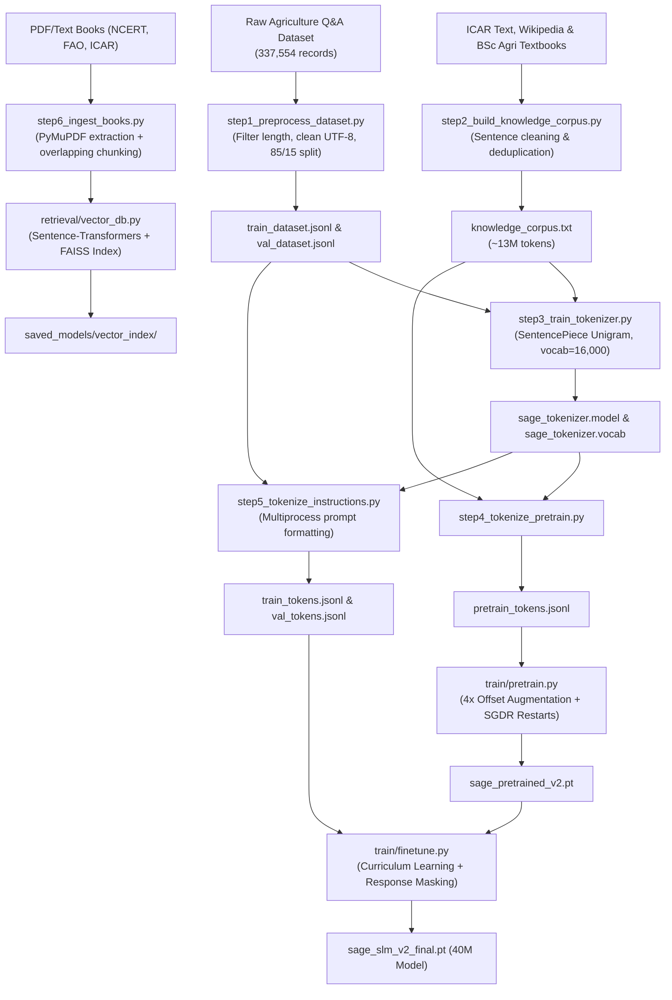
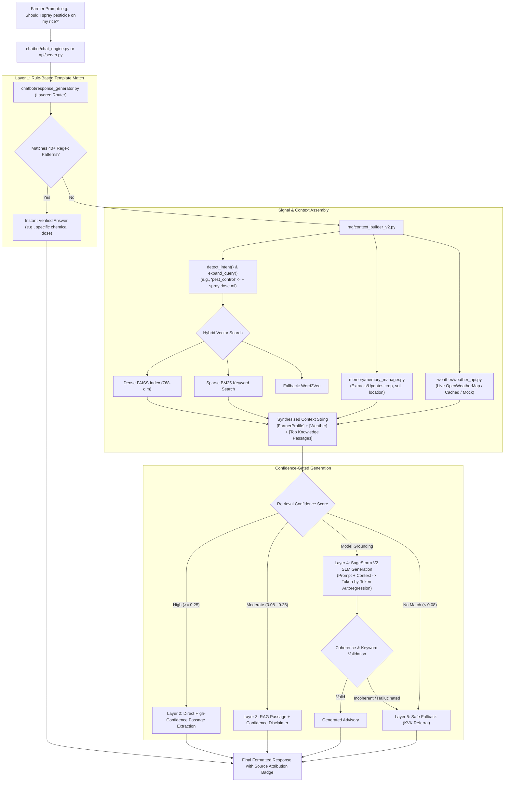

# SageStorm V2 Agriculture Chatbot — Comprehensive In-Depth Technical Report

---

## 1. Executive Summary & Design Philosophy

### What is SageStorm V2?
**SageStorm V2** is a domain-specialized, end-to-end AI agricultural advisory system. Rather than relying on multi-billion parameter general LLMs (like GPT-4 or LLaMA-70B), SageStorm is built around a custom **40-Million Parameter Small Language Model (SLM)** coupled with an intelligent **Hybrid Retrieval-Augmented Generation (RAG)** engine, a multi-turn **Farmer Profile & Memory Manager**, and real-time **Hyper-Local Weather Intelligence**.
```

┌──────────────────────────────────────────────────────────────────────────────┐
│                             SAGESTORM V2 SYSTEM                              │
├──────────────────────┬───────────────────────────────┬───────────────────────┤
│    SLM Core (40M)    │          Hybrid RAG           │   Context Awareness   │
│ • Custom Transformer │ • Dense FAISS (MiniLM-L6-v2)  │ • Farmer Profile      │
│ • RoPE + GQA         │ • Sparse BM25 + TF-IDF        │ • Live Weather Engine │
│ • SwiGLU + DropPath  │ • Word2Vec Legacy Fallback    │ • Intent Expansion    │
└──────────────────────┴───────────────────────────────┴───────────────────────┘
```

### Why This Architecture?
1. **Hallucination Control in Mission-Critical Farming Advice**: Incorrect pesticide doses or disease treatments ruin livelihoods. General models often hallucinate chemical measurements. SageStorm solves this with a **5-Layer Cascading Response Strategy** strictly anchored to agronomic textbooks (ICAR, FAO, NCERT).
2. **Computational & Edge Feasibility**: At ~40M parameters, the model requires under 200MB VRAM/RAM for inference, making it runnable on commodity hardware, budget cloud instances, and offline farm kiosks.
3. **Data-to-Parameter Sizing**: The pretraining corpus contains ~13M domain tokens. A 40M parameter model with heavy regularization (Drop-Path, Stochastic Depth, LayerScale, Token Noise) provides the optimal parameter-to-data ratio, avoiding the overfitting seen in larger configurations (74M+).
4. **Personalized Agronomy**: Questions like *"Should I spray today?"* or *"What fertilizer do I need?"* cannot be answered generically without knowing **where** the farmer is located, **what** crop/soil they have, and **whether** rain is expected.

---

## 2. End-to-End Project Flows

### Flow A: Training, Ingestion & Data Preparation Pipeline
This flow transforms raw agricultural texts and instruction pairs into trained neural model checkpoints and search indices.



---

### Flow B: Inference & Real-Time Query Execution Flow
This flow explains what happens the exact millisecond a farmer submits a prompt through the CLI, Gradio UI, or React Web App.



---

## 3. Comprehensive File-by-File Breakdown

Below is the exhaustive, in-depth explanation of every file and module across the codebase.

---

### A. Root Configuration & Entry Points

#### 1. [`config.py`](file:///c:/Users/HP/Music/sage%20strom%20model%20code/config.py)
* **Purpose**: Central nervous system containing all global configuration parameters, hyperparameters, directory paths, and runtime flags.
* **Key Components**:
  * **Model Hyperparameters**: `VOCAB_SIZE=16000`, `CONTEXT_LENGTH=512`, `EMBED_DIM=512`, `NUM_HEADS=8`, `KV_HEADS=4` (Grouped Query Attention ratio 2:1), `NUM_LAYERS=10`, `DROPOUT=0.15`, `FFN_MULT=2.667`. Total params: ~40M.
  * **Training Hyperparameters**: `PRETRAIN_BATCH=16`, `PRETRAIN_EPOCHS=80`, `PRETRAIN_LR_MAX=2e-4`, `FINETUNE_BATCH=16`, `FINETUNE_EPOCHS=40`, `FINETUNE_LR_MAX=5e-5`, `LABEL_SMOOTHING=0.1`.
  * **Retrieval & RAG Settings**: `RETRIEVER_TYPE="hybrid"`, `BM25_K1=1.5`, `BM25_B=0.75`, `HYBRID_ALPHA=0.6`, `RETRIEVAL_TOP_K=7`.
  * **Generation Settings**: `GEN_MAX_TOKENS=180`, `GEN_TEMPERATURE=0.65`, `GEN_TOP_K=40`, `GEN_TOP_P=0.88`, `GEN_REP_PENALTY=1.3`.
  * **Environment**: Automatic device detection (`cuda` with AMP if available, else `cpu`).

#### 2. [`main.py`](file:///c:/Users/HP/Music/sage%20strom%20model%20code/main.py)
* **Purpose**: Original baseline command-line interface entry point.
* **Functionality**:
  * Initializes the V1 retrieval pipeline (`ContextBuilder` with Word2Vec / TF-IDF).
  * Loads `SageStormV2` checkpoint if present; falls back to retrieval-only mode if PyTorch weights are missing.
  * Supports CLI arguments (`--demo`, `--weights`, `--city`, `--api_key`, `--verbose`, `--temperature`, `--max_tokens`).

#### 3. [`main_v2.py`](file:///c:/Users/HP/Music/sage%20strom%20model%20code/main_v2.py)
* **Purpose**: Upgraded, production-grade CLI entry point with VectorDB integration.
* **Functionality**:
  * Autodetects and initializes `VectorDB` (FAISS + BM25) from `saved_models/vector_index/`.
  * Intelligently selects `ContextBuilderV2` (1200-char context window) if VectorDB exists, else falls back to `ContextBuilder` V1.
  * Launches either the interactive terminal loop or the scripted multi-query demo showing full memory retention.

#### 4. [`setup.py`](file:///c:/Users/HP/Music/sage%20strom%20model%20code/setup.py)
* **Purpose**: Packaging and dependency specification for installing the SageStorm project as an editable Python package.

#### 5. [`requirements.txt`](file:///c:/Users/HP/Music/sage%20strom%20model%20code/requirements.txt)
* **Purpose**: Core dependencies manifest (`torch`, `sentencepiece`, `numpy`, `scikit-learn`, `tqdm`, `fastapi`, `uvicorn`, `gradio`).

#### 6. [`RAG_UPGRADE_GUIDE.md`](file:///c:/Users/HP/Music/sage%20strom%20model%20code/RAG_UPGRADE_GUIDE.md)
* **Purpose**: Architecture migration documentation outlining the transition from Word2Vec (V1) to Sentence-Transformers + FAISS + BM25 (V2).

---

### B. Data Pipeline (`data_pipeline/`)

#### 7. [`data_pipeline/run_pipeline.py`](file:///c:/Users/HP/Music/sage%20strom%20model%20code/data_pipeline/run_pipeline.py)
* **Purpose**: Master pipeline orchestrator. Executes all preprocessing and tokenization scripts in sequence.
* **Functionality**:
  * Supports resuming from specific steps (`--from N`) or running single steps (`--only N`).
  * Validates exit codes and ensures prerequisites exist before moving to downstream steps.

#### 8. [`data_pipeline/step1_preprocess_dataset.py`](file:///c:/Users/HP/Music/sage%20strom%20model%20code/data_pipeline/step1_preprocess_dataset.py)
* **Purpose**: Cleans, filters, and partitions the 337,554 raw agricultural Q&A dataset.
* **Technical Details**:
  * Applies an agricultural domain keyword filter (`_AGR_TERMS`) to remove out-of-domain noise.
  * Filters instructions to min 5 words and responses between 10 and 400 words.
  * Deduplicates instructions to avoid memorization of repetitive Q&A.
  * Splits clean data into **85% Training** (`train_dataset.jsonl`) and **15% Validation** (`val_dataset.jsonl`).

#### 9. [`data_pipeline/step2_build_knowledge_corpus.py`](file:///c:/Users/HP/Music/sage%20strom%20model%20code/data_pipeline/step2_build_knowledge_corpus.py)
* **Purpose**: Compiles the unstructured text corpus for pretraining.
* **Technical Details**:
  * Aggregates three major text sources: `ICAR_Text_Extracted.json` (47.5MB), `research_wikipedia_final_dataset.txt` (1MB), and `bsc agri.txt` (276KB).
  * Cleans boilerplate, extracts sentences, enforces a minimum length of 40 characters, and outputs `processed/knowledge_corpus.txt` (~13M tokens).

#### 10. [`data_pipeline/step3_train_tokenizer.py`](file:///c:/Users/HP/Music/sage%20strom%20model%20code/data_pipeline/step3_train_tokenizer.py)
* **Purpose**: Trains a custom SentencePiece tokenizer tailored to Indian agricultural terminology.
* **Technical Details**:
  * Builds a combined training corpus formatted with exact special tokens (`### Instruction:`, `### Input:`, `### Response:`).
  * Trains a **Unigram** model with vocabulary size 16,000 and 99.95% character coverage.
  * Exports `sage_tokenizer.model` and `sage_tokenizer.vocab`.

#### 11. [`data_pipeline/step4_tokenize_pretrain.py`](file:///c:/Users/HP/Music/sage%20strom%20model%20code/data_pipeline/step4_tokenize_pretrain.py)
* **Purpose**: Converts `knowledge_corpus.txt` into raw integer token sequences for self-supervised pretraining.
* **Technical Details**:
  * Encodes text line-by-line using `SentencePieceProcessor`.
  * Outputs `pretrain_tokens.jsonl` with token arrays ready for sequence packing.

#### 12. [`data_pipeline/step5_tokenize_instructions.py`](file:///c:/Users/HP/Music/sage%20strom%20model%20code/data_pipeline/step5_tokenize_instructions.py)
* **Purpose**: Tokenizes the instruction dataset for supervised fine-tuning using multi-core processing.
* **Technical Details**:
  * Uses Python's `multiprocessing.Pool` to parallelize encoding over CPU cores.
  * Applies `build_training_prompt()` ensuring target labels for the instruction portion can be masked during fine-tuning.
  * Outputs `train_tokens.jsonl` and `val_tokens.jsonl`.

#### 13. [`data_pipeline/step6_ingest_books.py`](file:///c:/Users/HP/Music/sage%20strom%20model%20code/data_pipeline/step6_ingest_books.py)
* **Purpose**: Extracts, chunks, and indexes agricultural PDFs and textbooks into the Vector Database and pretrain pool.
* **Technical Details**:
  * Integrates **PyMuPDF (`fitz`)** and `pdfminer` to extract text from PDFs (NCERT Class 11/12 Biology, ICAR Crop Guides, FAO Manuals).
  * Breaks text into 256-word overlapping chunks (32-word overlap) for dense retrieval.
  * Populates and saves the FAISS index + BM25 corpus to `saved_models/vector_index/`.

---

### C. Neural Network Architecture & Tokenizer (`models/`)

#### 14. [`models/sagestorm_v2.py`](file:///c:/Users/HP/Music/sage%20strom%20model%20code/models/sagestorm_v2.py)
* **Purpose**: Implements the full **SageStorm V2.2** deep learning architecture from scratch in PyTorch.
* **Architecture Details**:
  * **`RMSNorm`**: Root Mean Square Layer Normalization with learnable scaling, replacing standard LayerNorm for speed and training stability.
  * **`RotaryEmbedding` (RoPE)**: Rotary position embeddings applied to Query and Key projections, providing superior position extrapolation up to 512 context tokens.
  * **`SwiGLU`**: Swish Gated Linear Unit feed-forward layer (`dim * 2.667` hidden dimension rounded to nearest 64), providing richer representation capacity than standard ReLU/GELU.
  * **`GQA` (Grouped Query Attention)**: 8 query heads and 4 key/value heads (2:1 ratio). Reduces KV-cache memory bandwidth while retaining multi-head expressiveness.
  * **`Block` with Stochastic Depth (`_drop_path`)**: Implements Drop-Path with linearly increasing probability (from 0% at Layer 0 to 10% at Layer 9). Forces different subsets of transformer layers to learn independent features, preventing overfitting on 13M tokens.
  * **`LayerScale`**: Learnable residual branch multipliers (`ls1`, `ls2`) initialized to $10^{-4}$ for stable deep network convergence.
  * **Weight Tying**: Output projection matrix `head.weight` shares memory directly with `emb.weight`, saving 8.2M parameters.
  * **`generate()`**: Autoregressive decoding method supporting Temperature scaling, Top-K, Top-P (Nucleus) sampling, frequency-scaled Repetition Penalty, and Min/Max token limits.

#### 15. [`models/tokenizer.py`](file:///c:/Users/HP/Music/sage%20strom%20model%20code/models/tokenizer.py)
* **Purpose**: Wrapper around the SentencePiece tokenizer and prompt formatting engine.
* **Functionality**:
  * Standardizes prompt construction across training, RAG, and inference (`### Instruction:`, `### Context:`, `### Input:`, `### Response:`).
  * Provides `encode_prompt()` with explicit `BOS_ID` handling and `get_response_ids()` for locating target tokens during loss masking.

---

### D. Retrieval Engines (`retrieval/`)

#### 16. [`retrieval/vector_db.py`](file:///c:/Users/HP/Music/sage%20strom%20model%20code/retrieval/vector_db.py)
* **Purpose**: Dense semantic vector database engine powered by FAISS and Sentence-Transformers.
* **Technical Details**:
  * Converts text chunks into 768-dimensional dense vectors using models like `all-MiniLM-L6-v2` or `all-mpnet-base-v2`.
  * Builds and persists FAISS indices (`IndexFlatIP` on normalized embeddings for exact cosine similarity).
  * Implements hybrid search combining dense FAISS search with BM25 lexical ranking and metadata filtering.

#### 17. [`retrieval/vector_search.py`](file:///c:/Users/HP/Music/sage%20strom%20model%20code/retrieval/vector_search.py)
* **Purpose**: Sparse retrieval algorithms and lightweight fallback engines.
* **Technical Details**:
  * **`BM25Retriever`**: Custom pure-Python implementation of Okapi BM25 ($k_1=1.5, b=0.75$).
  * **`TFIDFRetriever`**: Sublinear TF-IDF index with cosine similarity.
  * **`HybridRetriever`**: Weighted rank-fusion combining BM25 lexical precision and TF-IDF semantic spread.
  * **`Word2VecRetriever`**: Legacy centroid-based cosine similarity retriever.

---

### E. RAG & Context Engineering (`rag/`)

#### 18. [`rag/context_builder.py`](file:///c:/Users/HP/Music/sage%20strom%20model%20code/rag/context_builder.py)
* **Purpose**: Version 1 baseline context builder combining Word2Vec retrieval, farmer memory, and weather signals.

#### 19. [`rag/context_builder_v2.py`](file:///c:/Users/HP/Music/sage%20strom%20model%20code/rag/context_builder_v2.py)
* **Purpose**: Version 2 production context assembly engine.
* **Technical Details**:
  * **Intent Classification**: Uses compiled regular expressions to categorize queries into `pest_control`, `disease_management`, `fertilization`, `spray_advisory`, `irrigation`, `crop_selection`, `planting`, `soil_management`, and `harvest_storage`.
  * **Query Expansion**: Automatically enriches the query with technical domain keywords prior to vector lookup (e.g., adding *"fungicide prevention control"* to disease questions).
  * **Multi-Signal Context Synthesis**: Builds a structured 1200-character prompt containing `[FarmerProfile]`, `[Weather]`, and `[KnowledgeBase / Book Sources]`, alongside returning a normalized retrieval confidence score.

---

### F. Memory & Context Persistence (`memory/`)

#### 20. [`memory/memory_manager.py`](file:///c:/Users/HP/Music/sage%20strom%20model%20code/memory/memory_manager.py)
* **Purpose**: Multi-turn dialogue memory and automated farmer profile extraction engine.
* **Technical Details**:
  * Contains exhaustive dictionaries of 50+ Indian crops (`KNOWN_CROPS`), all Indian states/UTs (`KNOWN_STATES`), and soil classifications (`SOIL_TYPES`).
  * Dynamically extracts entities from regular chat (e.g., *"I have 3 acres of paddy in Sivakasi with red soil"* -> captures crop=rice, size=3 acres, loc=Sivakasi, soil=red).
  * Normalizes land measurements across acres, bighas, hectares, and gunthas.
  * Maintains short-term session conversation buffers and persists long-term state to `farmer_profile.json`.

#### 21. [`memory/farmer_profile.json`](file:///c:/Users/HP/Music/sage%20strom%20model%20code/memory/farmer_profile.json)
* **Purpose**: JSON storage file for persistent farmer information across sessions.

---

### G. Weather Intelligence (`weather/`)

#### 22. [`weather/weather_api.py`](file:///c:/Users/HP/Music/sage%20strom%20model%20code/weather/weather_api.py)
* **Purpose**: OpenWeatherMap API client with agricultural rule heuristics and intelligent fallback.
* **Technical Details**:
  * `needs_weather(query)`: Detects if a question requires meteorological context (e.g., questions regarding spraying, rain, harvesting).
  * Fetches temperature, humidity, wind speed, precipitation probability, and weather condition strings.
  * In-memory caching for 30 minutes to minimize external API calls.
  * **Agronomic Advisory Generation**: Generates explicit actionable advisories (e.g., warning against chemical spraying if rainfall > 40% or wind > 20 km/h).
  * Includes a realistic seasonal simulation mock generator (`_mock()`) when running offline without an API key.

---

### H. Chatbot & Inference Engine (`chatbot/`)

#### 23. [`chatbot/chat_engine.py`](file:///c:/Users/HP/Music/sage%20strom%20model%20code/chatbot/chat_engine.py)
* **Purpose**: Interactive CLI loop manager for terminal users.
* **Functionality**:
  * Manages terminal conversation loops, handles commands (`profile`, `clear`, `exit`), formats visual banners, and displays source attribution badges (`[Template]`, `[RAG: ICAR]`, `[SageStorm SLM]`).

#### 24. [`chatbot/response_generator.py`](file:///c:/Users/HP/Music/sage%20strom%20model%20code/chatbot/response_generator.py)
* **Purpose**: The 5-Layer Cascading Response Strategy Router (20KB+ of core logic).
* **The 5 Layers**:
  1. **Layer 1: Rule-Based Templates (40+ Patterns)**: High-risk questions (exact fertilizer formulations, chemical dosages, spray timing) matched against verified agricultural protocols for 100% deterministic safety.
  2. **Layer 2: High-Confidence RAG (Score $\ge$ 0.25)**: Direct extraction of clean, complete sentences from indexed ICAR/FAO textbooks.
  3. **Layer 3: Low-Confidence RAG (Score 0.08–0.25)**: Extracted textbook passage accompanied by an advisory confidence disclaimer.
  4. **Layer 4: SageStorm V2 SLM Generation**: Autoregressive neural generation grounded on the synthesized RAG prompt, followed by coherence, length, and agricultural keyword verification.
  5. **Layer 5: Polite Fallback**: Safe referral to Krishi Vigyan Kendra (KVK) agricultural extension services when confidence is insufficient, preventing hallucinations.

---

### I. Training & Evaluation Engine (`train/`)

#### 25. [`train/pretrain.py`](file:///c:/Users/HP/Music/sage%20strom%20model%20code/train/pretrain.py)
* **Purpose**: Self-supervised causal language model pretraining script on the 13M token corpus.
* **Advanced Training Techniques**:
  * **4x Offset Block Packing**: Slides a context window with 4 distinct offsets across continuous tokens, effectively multiplying the training data 4-fold without extra text.
  * **Token Noise Injection**: 5% random token replacement during training to force context dependency and break rote memorization.
  * **SGDR (Cosine Annealing with Warm Restarts)**: Decays learning rate to $10^{-5}$ and restarts with $0.8\times$ peak LR to escape local minima.
  * **Automatic Mixed Precision (AMP)** & **Gradient Checkpointing**: Drastically reduces VRAM footprint during backward passes.

#### 26. [`train/finetune.py`](file:///c:/Users/HP/Music/sage%20strom%20model%20code/train/finetune.py)
* **Purpose**: Supervised instruction fine-tuning on the 337K Q&A dataset.
* **Technical Details**:
  * **Loss Masking**: Sets label indices of the prompt (`### Instruction: ... ### Response:`) to `-100` so Cross-Entropy loss is computed strictly on response tokens.
  * **Curriculum Learning**: Sorts training batches from shorter to longer responses over initial warmup epochs.
  * **Pretrain Data Mixing**: Mixes 5% pretrain data into fine-tuning batches to eliminate catastrophic forgetting.

#### 27. [`train/evaluate.py`](file:///c:/Users/HP/Music/sage%20strom%20model%20code/train/evaluate.py)
* **Purpose**: Comprehensive model validation suite.
* **Metrics Computed**:
  * Cross-Entropy Loss & Perplexity (PPL).
  * Next-token Prediction Accuracy & Top-5 Token Accuracy.
  * **BLEU-4** Score against ground-truth answers.
  * 4-gram Repetition Rate (to measure degenerative looping).
  * Expected Calibration Error (ECE) to assess model probability confidence.

---

### J. User Interfaces & Web API (`api/`, `ui/`)

#### 28. [`api/server.py`](file:///c:/Users/HP/Music/sage%20strom%20model%20code/api/server.py)
* **Purpose**: High-performance asynchronous REST API server built with FastAPI.
* **Endpoints**:
  * `POST /chat`: Receives `{ query, city, verbose }`, executes the 5-layer response engine, and returns `{ answer, source, latency_ms, timestamp }`.
  * `GET /weather`: Returns live/mock weather telemetry and rain probabilities for a city.
  * `GET /profile` & `POST /profile`: Read and update the farmer's stored profile attributes.
  * `GET /health` & `GET /stats`: System uptime, active backend, and session metrics.
  * Configured with Cross-Origin Resource Sharing (`CORSMiddleware`) for React and external mobile apps.

#### 29. [`ui/gradio_app.py`](file:///c:/Users/HP/Music/sage%20strom%20model%20code/ui/gradio_app.py)
* **Purpose**: Standalone, interactive web application built with Gradio.
* **Features**: Full chat window, live weather panel, editable farmer profile sidebar, and dynamic response attribution badges.

#### 30. [`ui/src/`](file:///c:/Users/HP/Music/sage%20strom%20model%20code/ui/src/), [`ui/index.html`](file:///c:/Users/HP/Music/sage%20strom%20model%20code/ui/index.html), [`ui/vite.config.js`](file:///c:/Users/HP/Music/sage%20strom%20model%20code/ui/vite.config.js), [`ui/package.json`](file:///c:/Users/HP/Music/sage%20strom%20model%20code/ui/package.json)
* **Purpose**: Modern single-page React frontend application bundled with Vite, offering a clean, mobile-responsive farmer dashboard.

---

## 4. Complete Tool & Technology Stack Justification

| Tool / Technology | Role in Project | Why We Use It |
|---|---|---|
| **PyTorch (`torch>=2.0`)** | Deep Learning Core | Powers the custom Transformer architecture (`SageStormV2`), native RoPE math, FlashAttention / SDPA primitives, and mixed-precision training. |
| **FAISS (`faiss-cpu`)** | Dense Vector Search | Meta’s library for sub-millisecond approximate nearest neighbor search over dense embeddings. Scales to millions of textbook passages with minimal RAM. |
| **Sentence-Transformers** | Semantic Embeddings | Transforms sentences into 768-dim dense representations using `all-MiniLM-L6-v2`, capturing semantic concepts that keyword searches miss. |
| **Rank-BM25** | Sparse Lexical Retrieval | Industry-standard Okapi BM25 ranking. Essential in agriculture for exact chemical matches (e.g., *"Chlorpyriphos"*, *"Imidacloprid"*). |
| **SentencePiece** | Subword Tokenizer | Unigram tokenization handles unseen agricultural terminology without out-of-vocabulary crashes, maintaining compact token sequences. |
| **PyMuPDF (`fitz`) & pdfminer** | Document Extraction | Rapidly ingests structured and unstructured agronomy PDFs, textbook chapters, and ICAR circulars. |
| **FastAPI & Uvicorn** | REST Backend Service | High-throughput asynchronous web API server with automatic Pydantic request validation and CORS support for React frontends. |
| **Gradio** | Rapid Prototyping UI | Enables zero-setup web interface deployment with live weather panels and real-time farmer profile editing. |
| **OpenWeatherMap API** | Environmental Intelligence | Supplies real-time rain, temperature, and wind data to prevent hazardous pesticide applications. |

---

## 5. Summary Matrix of Codebase Components

```
sage strom model code/
├── config.py                         # Global hyperparams, paths, and flags
├── main.py                           # Baseline V1 CLI entry point
├── main_v2.py                        # Production V2 CLI with VectorDB support
├── requirements.txt / setup.py       # Package dependencies & setup
│
├── data_pipeline/                    # Complete data processing subsystem
│   ├── run_pipeline.py               # Master pipeline runner
│   ├── step1_preprocess_dataset.py   # Cleans & splits 337K Q&A dataset
│   ├── step2_build_knowledge_corpus.py# Compiles 13M token ICAR text corpus
│   ├── step3_train_tokenizer.py      # Trains 16K SentencePiece tokenizer
│   ├── step4_tokenize_pretrain.py    # Generates pretrain token sequences
│   ├── step5_tokenize_instructions.py# Multiprocess instruction tokenization
│   └── step6_ingest_books.py         # Ingests PDF books into FAISS index
│
├── models/                           # Neural network & Tokenizer logic
│   ├── sagestorm_v2.py               # 40M SLM (RoPE, GQA, SwiGLU, DropPath)
│   └── tokenizer.py                  # Tokenizer wrapper & prompt formats
│
├── retrieval/                        # Search indices & retrievers
│   ├── vector_db.py                  # FAISS + Sentence-Transformers VectorDB
│   └── vector_search.py              # Okapi BM25, TF-IDF & Hybrid fusion
│
├── rag/                              # Context assembly & Intent engine
│   ├── context_builder.py            # Baseline context builder (V1)
│   └── context_builder_v2.py         # Advanced intent-aware context builder (V2)
│
├── memory/                           # Farmer memory & State
│   ├── memory_manager.py             # Entity extraction & multi-turn memory
│   └── farmer_profile.json           # Persistent profile storage
│
├── weather/                          # Weather APIs & Agronomic heuristics
│   └── weather_api.py                # OpenWeatherMap client & spray advisory
│
├── chatbot/                          # Inference & Response routing
│   ├── response_generator.py         # 5-Layer cascading response router
│   └── chat_engine.py                # Terminal interactive session loop
│
├── train/                            # Training & Evaluation routines
│   ├── pretrain.py                   # Offset-augmented pretraining with SGDR
│   ├── finetune.py                   # Masked-loss instruction fine-tuning
│   └── evaluate.py                   # BLEU-4, PPL, and calibration suite
│
├── api/                              # REST API subsystem
│   └── server.py                     # FastAPI backend server
│
└── ui/                               # User Interfaces
    ├── gradio_app.py                 # Gradio web dashboard
    └── src/, index.html, vite.config # Vite + React frontend dashboard
```
